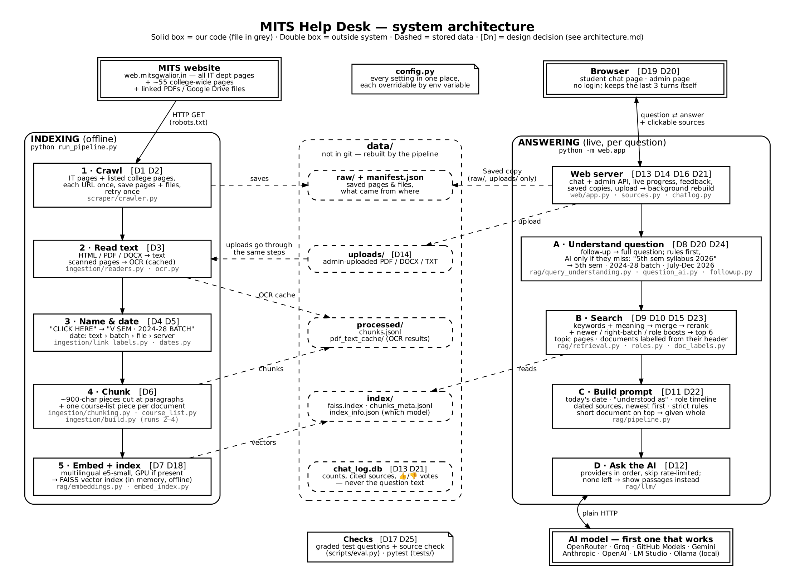
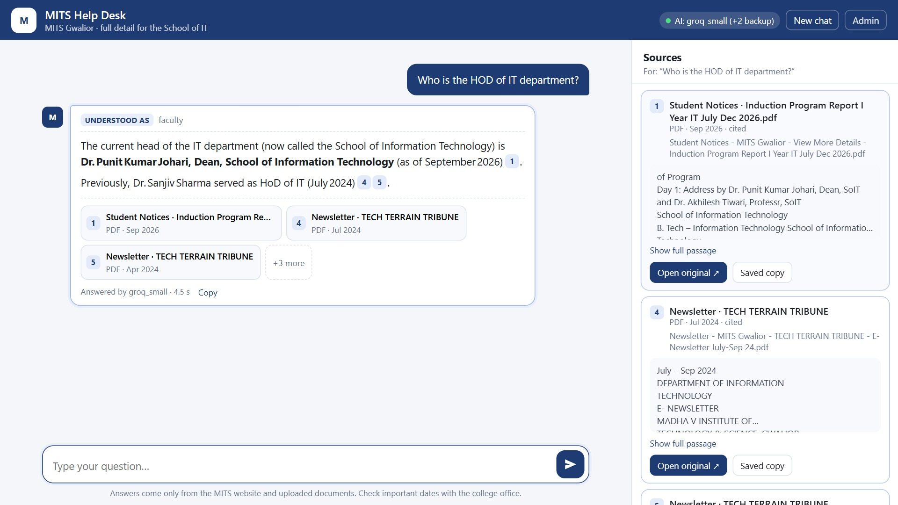
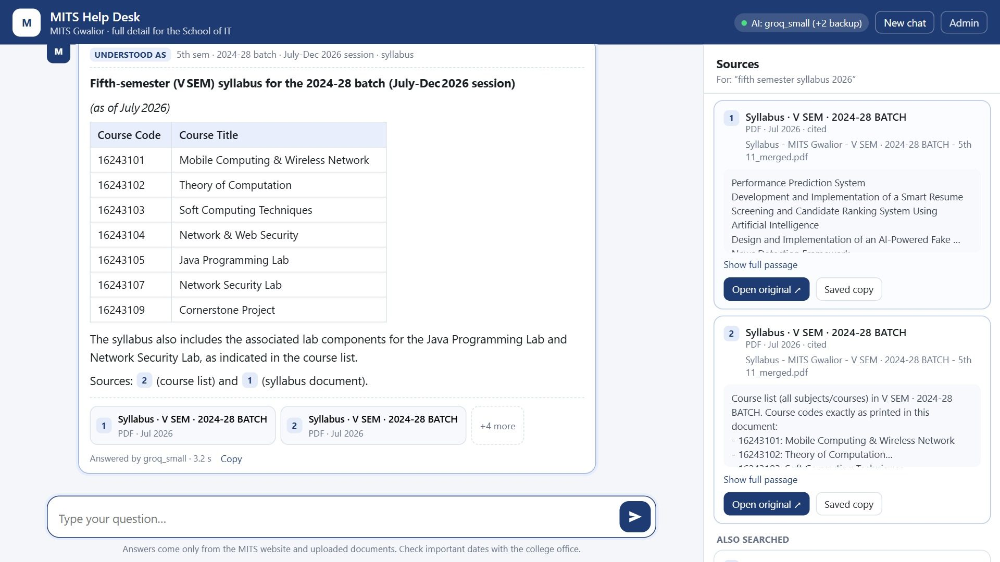
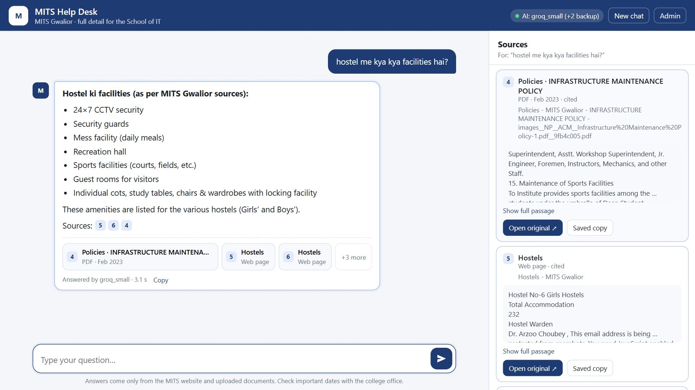
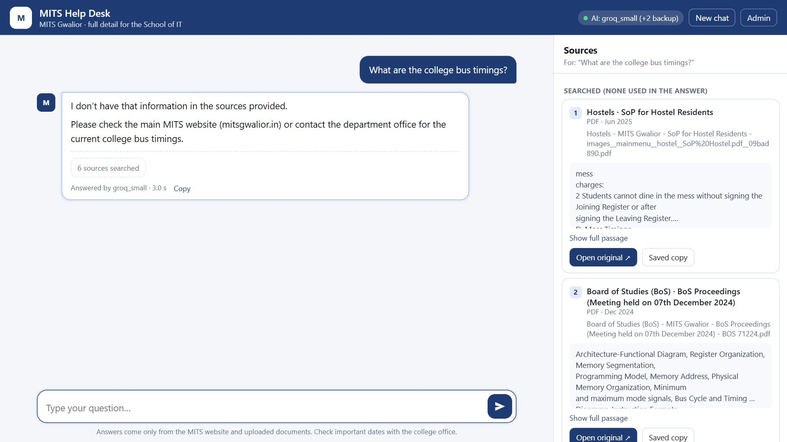

# MITS Help Desk

A chatbot that answers students' questions about **MITS Gwalior**, using only the college's own website and documents, and shows the source of every answer. It covers the **IT department in full** (every page and every PDF it links to, scanned ones included) plus the main **college-wide pages** (rules and ordinances, academic calendar, exams, fees, admissions, hostels, library, student cells, placement, notices). It's an MVP built for one department; other departments are added the same way.

It reads every page and PDF, gives every piece of text a date, and answers with a hybrid search and an AI model of your choice. One session, no login, nothing stored: reload and the chat is gone.

- **Which doc to read for what:** [docs/README.md](docs/README.md)
- **How it works, with diagrams and every design decision:** [docs/architecture/architecture.md](docs/architecture/architecture.md)
- **Each feature in plain words (why / what / where):** [docs/FEATURES.md](docs/FEATURES.md)



| | |
|---|---|
|  |  |
|  |  |

## Quick start

**Windows, one command:** `powershell -ExecutionPolicy Bypass -File .\run_demo.ps1` sets everything up and starts it (CPU only). Step by step and how to update: [HOW_TO_RUN.md](HOW_TO_RUN.md).

By hand:

Install [uv](https://docs.astral.sh/uv/), then:

```bash
uv sync --extra cpu  --extra ocr    # laptop (CPU)
uv sync --extra cuda --extra ocr    # PC with an NVIDIA GPU
                                    # add --group dev to either line to get pytest

uv run run_pipeline.py              # crawl + build the index (once)
uv run -m web.app                   # http://localhost:5000   (admin: /admin)
```

> **Important:** plain `uv run` re-installs the *default* setup, which swaps out the PyTorch build you chose. After `uv sync --extra …`, either use `uv run --no-sync …`, or set it once per terminal: PowerShell `$env:UV_NO_SYNC = "1"`, bash `export UV_NO_SYNC=1`. The commands below assume you did.

Without uv: `pip install -r requirements.txt` (generated from `uv.lock`), then use `python` instead of `uv run`.

## Choose the AI model

Set one or more API keys. Every provider with a key is tried in order; if one fails or is rate-limited, the next one answers. If none answers, the chat shows the matching passages instead.

| Provider | Key | Model (default) |
|---|---|---|
| OpenRouter (free `:free` models) | `OPENROUTER_API_KEY` | `OPENROUTER_MODEL` (`nvidia/nemotron-3-ultra-550b-a55b:free`) |
| Groq (free tier) | `GROQ_API_KEY` | `GROQ_MODEL` (`openai/gpt-oss-120b`) |
| Groq, smaller model (own free allowance) | same `GROQ_API_KEY` | `GROQ_SMALL_MODEL` (`openai/gpt-oss-20b`) |
| GitHub Models | `GITHUB_MODELS_TOKEN` | `GITHUB_MODELS_MODEL` (`openai/gpt-4.1-mini`) |
| Gemini | `GEMINI_API_KEY` | `GEMINI_MODEL` |
| Anthropic | `ANTHROPIC_API_KEY` | `ANTHROPIC_MODEL` |
| OpenAI | `OPENAI_API_KEY` | `OPENAI_MODEL` |
| LM Studio / llama.cpp / vLLM | `OPENAI_COMPAT_BASE_URL` | `OPENAI_COMPAT_MODEL` |
| Ollama (local, no key) | `OLLAMA_BASE_URL` | `OLLAMA_MODEL` |

Easiest: copy `.env.example` to `.env` and paste your keys there (it's never uploaded to git). Or set them as environment variables.
Pick your own order: `LLM_PROVIDERS=groq,groq_small,openrouter,ollama`.

Free-tier limits to know: Groq's big model allows 8,000 tokens a minute and 200,000 a day (one question uses about 3,000–5,000, so about 1–2 questions a minute and 50–60 a day); `groq_small` has its own allowance, so it is the natural next step in the chain. OpenRouter's free models allow 50 requests a day.
PowerShell: `$env:GROQ_API_KEY = "gsk_..."` · bash: `export GROQ_API_KEY=gsk_...`

Free model names change over time; override the `*_MODEL` variable if a default disappears.

## Everyday commands

| Do this | Command |
|---|---|
| Crawl again + rebuild | `uv run run_pipeline.py` |
| Rebuild without crawling (after changing settings) | `uv run run_pipeline.py --skip-crawl` |
| Crawl only / chunks only / index only | `uv run -m scraper.crawler` · `uv run -m ingestion.build` · `uv run -m rag.embed_index` |
| Ask from the terminal | `uv run -m rag.pipeline "Who is the HOD?"` |
| See exactly what the AI receives | `uv run -m rag.pipeline --show-prompt "question"` |
| Grade the test questions (78) | `uv run scripts/eval.py` → `data/eval_report.md` |
| Check search finds the right documents (no answers) | `uv run scripts/eval.py --sources` |
| Run tests | `uv run pytest tests -q` |

More checking tools (crawl, links, retrieval debugging, batch answers) are listed in [docs/FEATURES.md](docs/FEATURES.md#everyday-commands).

## Does it answer correctly?

66 test questions (labs, School vs department, schemes, college-wide rules / fees / hostel / exams, things the site doesn't cover, "where is…", mandatory tasks, contacts, timetables, typos, follow-ups) are graded with `uv run scripts/eval.py`. **43/55 before the fixes (30 Oct) → 61/63 with the college pages → 62/66 on 31 Oct with follow-ups (3/3) and whole-document mode, on Groq, median 5.4 s per answer.** Details: [docs/FEATURES.md](docs/FEATURES.md#14-66-test-questions-graded-automatically).

## Settings

Every setting is in `config.py` and can be overridden with an environment variable of the same name, e.g. `EMBEDDING_DEVICE=cpu`, `RERANKER_MODEL=none` (faster on a slow laptop), `OCR_ENGINE=rapidocr`, `ADMIN_PASSWORD=...` (default `mits-admin`; change it before any shared demo).

## Reuse it, and what's next

- **Another website or your own files:** the scraper, ingestion and RAG stages are separate. See [docs/REUSE.md](docs/REUSE.md).
- **Open work** (timetable grid read cell by cell, college hours from real classes): [docs/NEXT_STEPS.md](docs/NEXT_STEPS.md).

## Scope and privacy

- The crawler only contacts `web.mitsgwalior.in`: it follows the IT department's pages, fetches a fixed list of college-wide pages without following their links, visits each URL once, and respects `robots.txt`.
- Question and answer text is **never stored**: the log keeps only counts and which sources were cited.
- `data/` (crawl, index, log) is not in git; `run_pipeline.py` rebuilds it.
