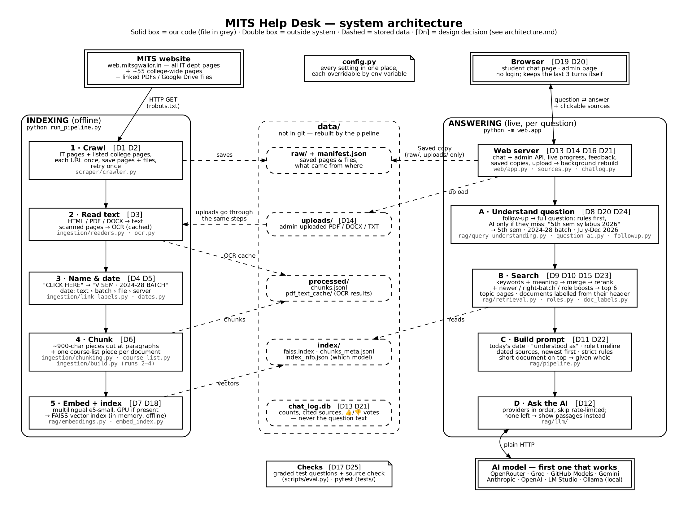
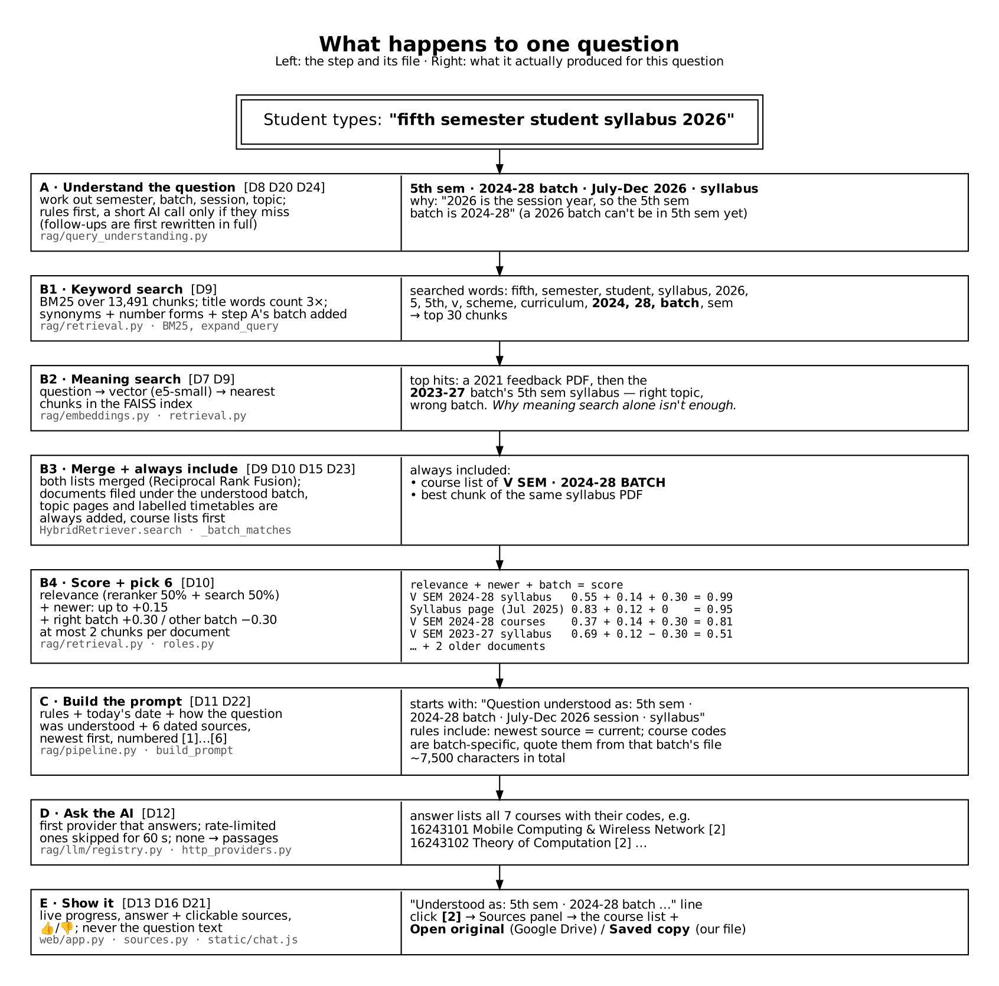

# Architecture — MITS IT Help Desk

A chatbot that answers questions about the MITS IT department **only from the department's own website and documents**, and shows where each answer came from.

It has two halves that never run at the same time:

- **Indexing (offline):** collect the website, read every page and PDF (including scans), and store it as searchable pieces. Run with `python run_pipeline.py`, or automatically after an admin upload.
- **Answering (live):** for each question, understand it, find the best pieces, and have an AI write an answer from *only* those pieces, with numbered sources.

They share one folder, `data/`. Indexing writes it; answering reads it.

*Boxes show the file that does the work. Tags like **[D3]** point to the decision table below.*

---

## What happens to one question

A real question traced through the system. The values on the right are actual output from the index (Oct 2026).

---

## Design decisions

Each row answers: what we chose, why, and what we did **not** choose. D15–D17 came from testing with 55 real-style questions.

| # | Decision | Why | Not chosen (and why not) |
|---|---|---|---|
| **D1** | **Scope-locked crawl.** Only `web.mitsgwalior.in`, only IT pages (URL prefix + the department's own sidebar menu), only the page's main content area. | The bot must answer about the IT department, not the whole university. Site-wide menus link hostel or NAAC PDFs that would pollute answers. | Crawling the whole site: more data, but mostly irrelevant and slower. |
| **D2** | **Visit each URL once; safe writes; retry once.** Files are written to a temp file and then swapped in. A stopped crawl keeps the last complete `manifest.json`. Timeouts and 5xx errors are retried once. | No loops on cyclic links, no half-written files if you press Ctrl+C, and one network hiccup doesn't drop a page. | Endless retries: one dead link could stall the crawl. Resuming a stopped crawl: not needed, since a full crawl of ~30 pages takes minutes. |
| **D3** | **OCR for scanned pages**: EasyOCR on the GPU (~2 s/page), RapidOCR on a CPU (~10 s/page). Results are cached by the **file's content**, not its path. | 1,737 of 4,896 PDF pages were scans with no text, including 14 of 19 pages of the 2026 V SEM syllabus. Caching by content means a copied `data/` folder on the laptop never redoes the 1-hour OCR. | Tesseract needs a system install on every machine. Skipping scans loses a third of the content. |
| **D4** | **Name files from where they're linked.** A "CLICK HERE" link in a table becomes "V SEM · 2024-28 BATCH" (row + column header). | File names like `5th 11_merged.pdf` say nothing about the batch, so the bot couldn't tell this year's syllabus from last year's. | Using file names: they don't carry the batch. Asking staff to rename files: not in our control. |
| **D5** | **Date every chunk, best clue first:** full date in the text ("w.e.f. 27/07/2026") › semester start from the batch label › the PDF's own date › server date › a bare year (last, since it's often a book's year). | Without dates, "who is the HOD" mixed 2019 and 2026 documents (temporal hallucination). A bare "2000" from a book list once made this year's syllabus look 26 years old. | Crawl date: every file would look new. No dates: old facts win as often as new ones. |
| **D6** | **Paragraph-aware chunks** (~900 characters, 150 overlap, cut at paragraph/sentence ends) **plus one course-list chunk per document** (name + code, found by layout). | Fixed 1000-character cuts split names from titles. A course list answers "which subjects" in one piece, and finding it by layout works for both old 7-digit and new 8-digit codes. | Fixed-size cuts (the original version). Matching an exact code format: it would break whenever codes change again. |
| **D7** | **Multilingual e5-small embeddings**, GPU if present, otherwise CPU. The index records which model built it. | Handles English, Hindi and Hinglish; small enough for a laptop CPU. Recording the model stops a model change from silently returning nonsense. | MiniLM (the original model): English-only. Large embedding models: too slow on the demo laptop. |
| **D8** | **Rule-based query understanding**: semester, batch, session and topic are worked out before searching. | Documents are filed by batch, but students ask by semester or year ("5th sem syllabus 2026", "3rd year ka TT"). Rules are instant, free and predictable. | An AI rewriting every question: adds 0.5–1 s and costs a call each time. Can be added later as a fallback; it's one function, `understand()`. |
| **D9** | **Hybrid search**: keyword search (BM25, title words ×3, synonyms like HOD → head/dean) **+** meaning search (vectors), merged, then re-scored by a small reranker (blended 50/50 with search scores). | Meaning search alone missed names and codes, and ranked last year's syllabus first (see the flow above). Keywords alone miss paraphrases. The blend stops the reranker from burying a strong match. | Vectors only (the original version). LlamaIndex: offers the same parts, but adds a heavy dependency and code that's harder to explain; it wouldn't fix the date problem by itself. |
| **D10** | **Ranking boosts:** newer chunks get up to +0.15 (fading over 6 years); the understood batch gets +0.30 and other batches −0.30; role questions always include the newest named holders; at most 2 chunks per document; 6 chunks go to the AI. | Relevance alone can't tell current from old, or this batch from last batch. The per-document cap stops one long PDF from filling every slot. | Filtering out old documents entirely: then "who was HOD in 2024?" couldn't be answered. |
| **D11** | **Date-aware prompt:** today's date, "question understood as …", a timeline of role holders, every source with its date (newest first), and strict rules (newest = current; "from X to Y" means it's over; course codes are batch-specific; say "not in the sources" instead of guessing; reply in the student's language). | Models trust whatever they read first. Giving them dates and ordering makes the right answer the obvious one, even for a small local model. | Plain "context + question" prompt (the original version): the source of the wrong-HOD answers. |
| **D12** | **AI provider chain over plain HTTP.** One small interface; OpenRouter, Groq, GitHub Models, Gemini, Anthropic, OpenAI, LM Studio and Ollama are all called with `requests`. A rate-limited provider is skipped for 60 s; if none works, the matching passages are shown instead. | Free tiers have low limits, and a demo must not die on "429 Too Many Requests". No vendor SDKs to install or keep in sync. | One fixed provider (the original version). Vendor SDKs: four extra dependencies doing what one HTTP call does. |
| **D13** | **Privacy and safety:** question and answer text is never stored (only counts and cited sources). Saved copies are served only from `data/raw/` and `data/uploads/`. Uploads and deletes need the admin password. | Students ask personal or embarrassing things. The file endpoint must never expose the index or the log. | A "recent questions" list: removed on request. |
| **D14** | **Admin uploads go through the same pipeline** and trigger a background rebuild. | One way to index means one set of bugs. It's also the "index at upload time" pattern a college would use if this ran inside its own website. | A separate upload-only index: two code paths to keep in sync. |
| **D15** | **Topic pages and scope rules.** Questions about labs, contacts, programmes or the department in general get that website page whole (`config.TOPIC_PAGES`); the prompt says to answer only from the IT site, never to read out students from lists, and to say which "lab" it means. | Testing showed the bot missed the Laboratories page ("labs" ≠ "laboratories"), turned a 2019 magazine joke into "yes, there is a mess", gave another college's address from a BoS member list, and listed debarred students by name. | A bigger model alone: it would still not see the Laboratories page, and a privacy rule is cheaper than trusting the model. |
| **D16** | **Live progress while answering**: the server streams one line per step (understood, searching, sources found, which AI is writing, fallbacks) and the chat shows them as a checklist. | A 10-second wait with a spinner looks broken; showing what it's reading also builds trust. | Fake progress messages on a timer: they would lie when a step is slow. WebSockets: more moving parts than a streamed response. |
| **D17** | **55 graded test questions** (`scripts/eval.py`) run after every change. | Each fix in D15 was found by them, and they show the fixes didn't break anything else. | Judging answers by hand each time: slow and easy to fool yourself. An AI judge: costs calls and needs its own checking. |

---

## Folder map

What each folder is for, and why each file lives where it does. The four code folders are the stages of the pipeline, in order: **scraper → ingestion → rag → web**.

| Folder | What it does | Files |
|---|---|---|
| `scraper/` | **Collects** the website. Knows about URLs and HTTP; nothing about text or AI. | `crawler.py`: scope rules, visit-once queue, safe file writes, retries, `manifest.json` |
| `ingestion/` | **Turns files into dated chunks.** Knows about file formats and text; nothing about search or AI. | `build.py`: entry point, turns crawl + uploads into `chunks.jsonl` · `readers.py`: HTML/PDF/DOCX → text · `ocr.py`: scanned pages → text · `link_labels.py`: "CLICK HERE" → "V SEM · 2024-28 BATCH" · `dates.py`: finds dates in text · `chunking.py`: cuts text into dated chunks · `course_list.py`: course name + code lists |
| `rag/` | **Finds and answers.** Embeddings, the index, search, prompt, AI. | `pipeline.py`: question → answer, ties the parts together · `query_understanding.py`: semester/batch/session from the question · `retrieval.py`: hybrid search and ranking · `roles.py`: who holds which post · `embeddings.py`: text → vectors (GPU/CPU) · `embed_index.py`: builds the FAISS index · `llm/`: AI providers (`base.py` interface, `http_providers.py` the HTTP calls, `registry.py` order + fallback) |
| `web/` | **Shows it.** The website and its API. | `app.py`: the URLs (routes) only · `sources.py`: source names, links, citations, saved-page view · `chatlog.py`: usage counts (no question text) · `static/`: chat and admin pages (HTML/CSS/JS) |
| `scripts/` | **Tools for checking the system.** Not used by the app. | `check_crawl.py`: did the crawl get everything? · `check_links.py`: does every source open? · `debug_retrieval.py`: why was a chunk (not) found? · `eval.py` + `eval_questions.json`: ask and grade the 55 test questions · `ask_batch.py`: answer your own list of questions |
| `tests/` | **82 automated tests**, one file per module. Run with `uv run pytest tests -q`. | `test_<module>.py` |
| `docs/` | **Documentation.** | `architecture/`: this file + diagrams (`.dot` source and `.png`) · `FEATURES.md`: what each feature does, in plain words · `evaluation/`: synopsis, presentation, and `architecture_v1_original.png` (the first design, kept because the synopsis and slides use it) |
| `data/` | **Everything the pipeline produces.** Not in git, because it's large and can be rebuilt. The repo only has an empty `data/.gitkeep` so the folder exists after cloning. | `raw/` + `manifest.json` (crawl) · `uploads/` (admin files) · `processed/` (`chunks.jsonl`, `pdf_text_cache/`) · `index/` (FAISS + chunk metadata + which model built it) · `chat_log.db` |
| *(root)* | **Start points and settings.** | `run_pipeline.py`: crawl → chunks → index · `config.py`: every setting, each overridable by an environment variable · `pyproject.toml` + `uv.lock`: dependencies (`uv sync`) · `requirements.txt`: the same, generated from `uv.lock` for plain pip |

**What changed in the October 2026 clean-up:** `ingestion/extract.py` was split into `readers.py`, `chunking.py` and `build.py`; role matching moved from `retrieval.py` to `rag/roles.py`; source naming and saved pages moved from `web/app.py` to `web/sources.py`. Behaviour was checked to be identical: all tests pass, the same 9,348 chunks are built, and the same sources and prompt come out for 8 test questions.

---

## Changing things

| To… | Change | Then |
|---|---|---|
| Use a different AI | Set `LLM_PROVIDERS=groq,openrouter,ollama` and the key (e.g. `GROQ_API_KEY`) | Restart the web app |
| Add an AI provider | If it speaks the OpenAI format: one entry in `config.PROVIDER_SETTINGS`. Otherwise: one class in `rag/llm/http_providers.py` | — |
| Support a new file type | One function in `ingestion/readers.py` | `python run_pipeline.py --skip-crawl` |
| Change the embedding model | `EMBEDDING_MODEL=...` | Rebuild; the index refuses a mismatched model |
| Change chunk size, dates, course lists | `ingestion/chunking.py`, `dates.py`, `course_list.py` | Rebuild (OCR is cached, ~1 min on GPU) |
| Tune ranking | `TITLE_WEIGHT`, `RECENCY_WEIGHT`, `BATCH_MATCH_BONUS`, `RERANKER_BLEND`, `TOP_K` in `config.py` | Restart; check with `scripts/eval.py` |
| Edit the diagrams | `architecture.dot`, `question-flow.dot` in this folder | `dot -Tpng -Gdpi=150 architecture.dot -o architecture.png` (same for the other) |
